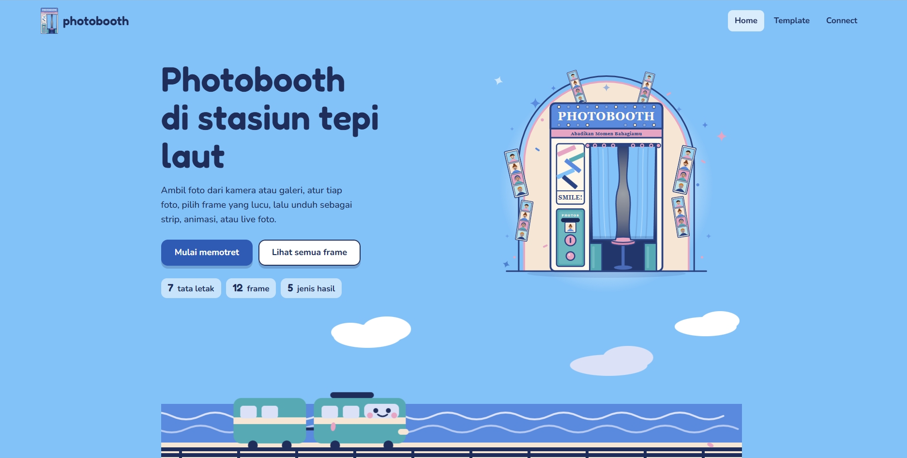
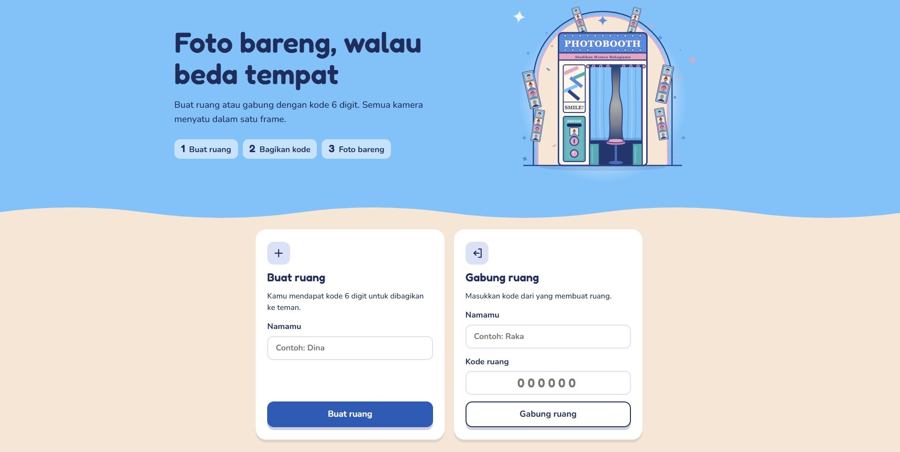
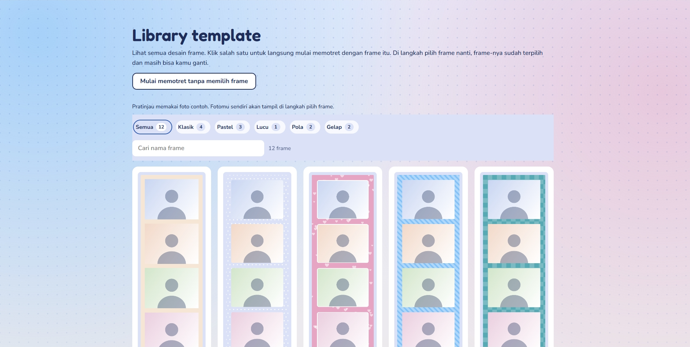

  

<h1 align="center">Waktu Bersama</h1>

  Ruang virtual untuk membuat jarak terasa dekat. Berfoto dalam satu frame lewat photobooth real-time, main game berdua atau bareng-bareng, dan ciptakan momen seru dari mana saja. 
  <b>Mulai kebersamaan</b>

  <a href="https://www.waktubersama.my.id"><b>www.waktubersama.my.id</b></a>

---

## Tampilan

| Connect Photobooth | Library Frame |
|---|---|
|  |  |

## Tentang proyek

**Waktu Bersama** hadir untuk menjembatani jarak bagi pasangan LDR, keluarga, sahabat, maupun siapa saja yang ingin menghabiskan waktu berkualitas secara daring. Bukan sekadar panggilan video biasa, platform ini menggabungkan keseruan **Photobooth interaktif**—yang memungkinkan dua orang atau lebih berfoto di dalam satu bingkai yang sama secara langsung—dengan berbagai **mini-game santai** untuk dinikmati bersama tanpa terasa terpisah jarak.

## Alur penggunaan

1. Pengguna membuka aplikasi dan memilih aktivitas (**Photobooth** atau **Mini-Game**)
2. Buat ruang (*room*) baru untuk mendapatkan **Kode Room / Link Undangan**
3. Bagikan kode atau tautan tersebut kepada pasangan, teman, atau keluarga
4. Setelah terhubung di dalam satu ruang, pengguna dapat langsung berpose bersama di kamera atau mulai bermain
5. Atur tata letak foto, pilih desain frame, dan tambahkan filter sesuai selera
6. Unduh hasil foto bersama dalam berbagai format untuk disimpan atau dibagikan ke media sosial

## Fitur utama

### Photobooth & Mode Connect
- **Mode Connect (Foto Jarak Jauh):** Menggabungkan tampilan kamera dari perangkat yang berbeda ke dalam satu bingkai foto secara *real-time*
- **Mode Solo & Galeri:** Tetap bisa digunakan sendiri dengan mengambil foto langsung dari kamera maupun mengunggah foto dari galeri perangkat
- **Library Frame:** Koleksi bingkai lucu, estetik, dan tematik yang beragam untuk mempercantik hasil foto
- **Kustomisasi Foto:** Mengatur posisi tiap pose, memilih tata letak (*grid* / *photo strip*), dan menyesuaikan warna latar
- **Multi-Format Ekspor:** Unduh hasil akhir sebagai **Photo Strip** (PNG/JPG), **Animasi** (GIF), maupun **Live Foto** (Video pendek)

### Ruang Bermain (Mini-Games)
- **Main Bareng Real-Time:** Pilihan permainan ringan dan interaktif yang dirancang untuk dimainkan berdua atau dalam grup kecil
- **Sesi Privat & Instan:** Cukup masuk menggunakan kode ruang tanpa proses pendaftaran yang rumit untuk langsung mulai bersenang-senang

### Pengalaman Pengguna
- **Akses Lintas Perangkat:** Ringan dan responsif saat diakses melalui browser ponsel maupun desktop
- **Pemrosesan Cepat:** Pengambilan gambar dan penyusunan frame berjalan mulus dengan antarmuka yang bersih dan intuitif

## Teknologi

- **Frontend:** HTML, CSS, dan JavaScript (Vanilla / Tanpa framework berat) dengan HTML5 Canvas untuk pengolahan gambar dan animasi
- **Real-Time Communication:** WebRTC & WebSocket untuk sinkronisasi kamera dan sesi bermain secara langsung
- **Backend:** Node.js (Serverless)
- **Database & Penyimpanan:** PostgreSQL

## Link

[www.waktubersama.my.id](https://www.waktubersama.my.id)